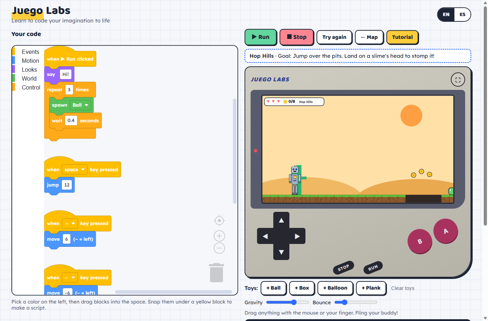
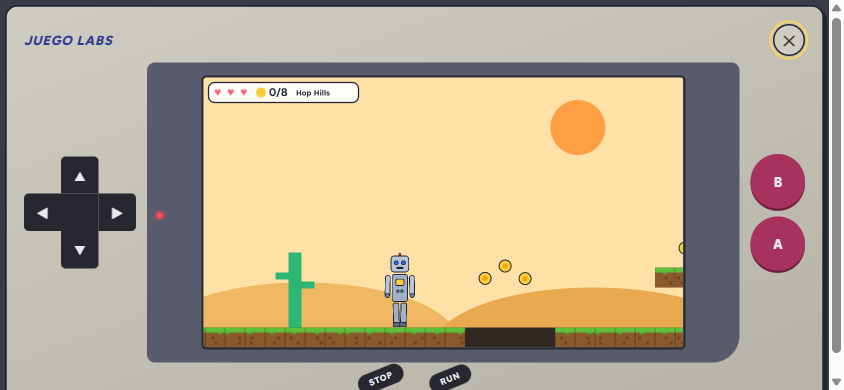
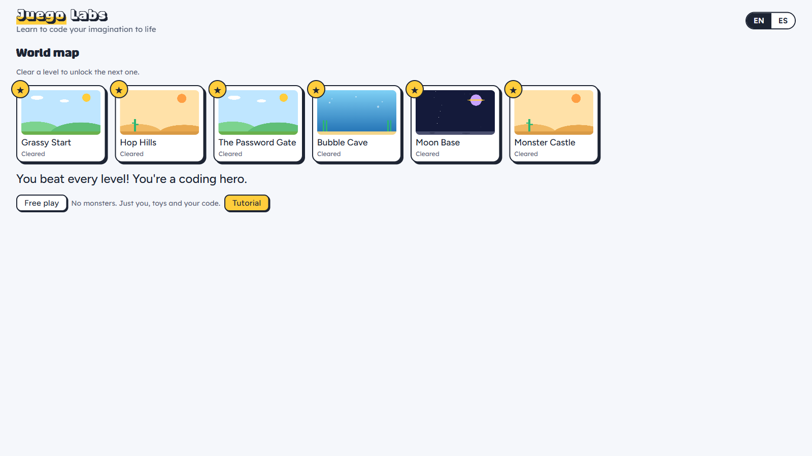
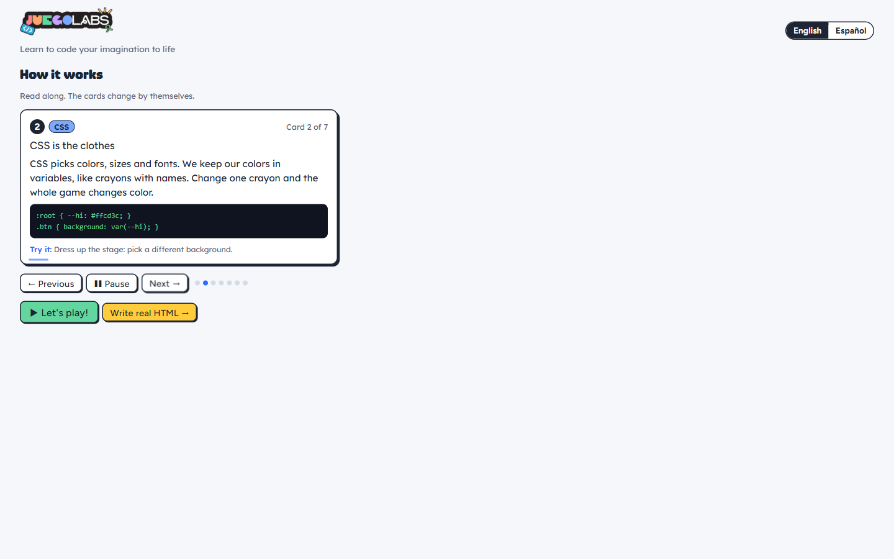
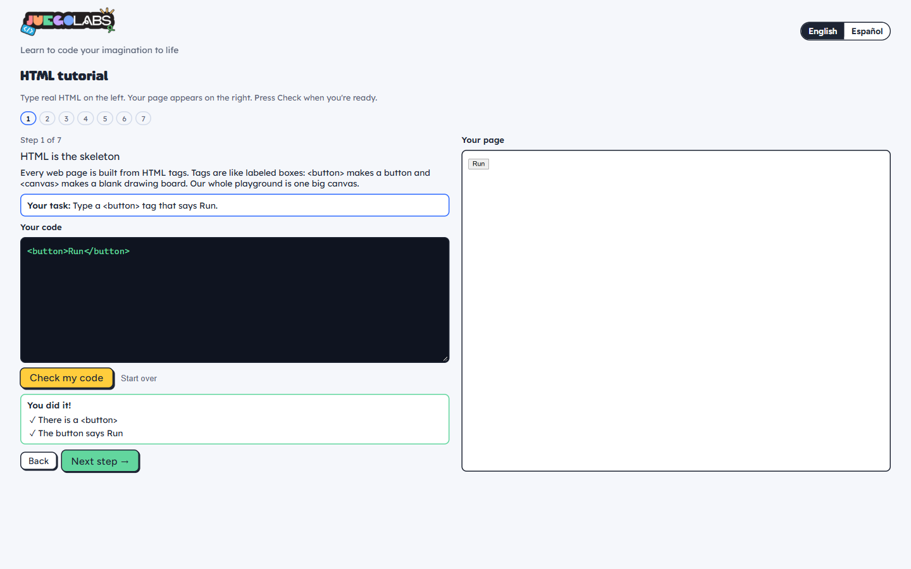

# Draw, Code and Play with Juego Labs!

Juego Labs is an interactive bilingual coding playground where kids can draw their own character, bring it to life with code blocks, and play through monster-filled levels.
My main goal was to create an open-access e-learning resource that helps students ease into coding.
Designed with elementary and middle school students in mind, this website is a great fit for classrooms, coding clubs, and home.
No account needed, no installation, and it works on laptops, tablets, and phones.

**[▶ Play Juego Labs] (https://gisellegat.github.io/Juego-Labs/)** · [Run it on your own computer](#run-it-yourself)



## Why Juego Labs?
As I researched inspiration for my design project, I realized that most bilingual coding websites are either out of date, too simplified, don't teach the code, or sell physical products aimed at toddlers.
Additionally, growing up in a Hispanic community, computer science was rarely discussed, and I found that most of my peers weren't introduced to coding until late in high school or early in college.
With three younger siblings, I want them to have the opportunity to explore computers. Since they are artists, I included a custom character designer in my project to motivate them by letting them see their drawings come to life on screen and then play with them.
I was inspired by Melon Playground, a ragdoll engine where you can build your own structures. I liked the fact that it had blocks and a canvas where you could draw your own characters. I focused on teaching code, not just throwing users into the design with little to no navigation.

## How Juego Labs Works
After character selection, two options pop up on screen: “Let's Play” and “Tutorial”
Let’s Play
1. ** Pick your character** On the home screen, you can choose from three pre-made characters: a robot, a cat, or an astronaut, or you can design your own, which opens up the canvas and gives you instructions on how to design your character. You can name it, then choose from the pre-made backgrounds. From the desert to space: your character knows no bounds
- **Snap code blocks.** Like Scratch: "when space is pressed → jump 12". A terminal right beside your code shows each block as real JavaScript or as a real HTML page.
- **Learn on a Game Boy.** "Let's play" puts the 7 “How-it-works” cards next to the Game Boy. Each card asks for one thing (press Run, jump, switch the terminal to HTML…), checks that you did it, and moves on.
- **Play on a Game Boy. **** The game lives inside a Game Boy with a touch D-pad and A/B buttons. Tap ⛶ to pop it full screen on a tablet or phone; tap ✕ to go back.



After the last card, 6 Mario-style levels test what you learned: grab coins, stomp slimes, bats, and a boss, and open a password gate with a code.
Tutorial
A simple “Tutorial” option lets users learn HTML without the gaming element. This mode plays the same cards one by one, like a slideshow. At the end, **Write real HTML** opens 7 hands-on steps: type HTML, watch your page appear, and press "Check my code" for ✓ and ✗ feedback.





## Who It's For

- **Teachers and schools** — a free, bilingual intro to HTML, CSS, and JavaScript that runs in any browser, with no logins to manage.
- **Students** — make a character that's truly yours, learn how real code works, and beat every level.

## Demo video

▶ **Demo video:** _add the video link here (YouTube, Loom or a file in this repo)_

## Solo Team

Karla Quintanar
B.S. Interactive Major at Kennesaw State University
Minor in Software Engineering

## Track and challenges

- **Main track:** Creative
- **Side challenges:** Small Business Challege by Replit

## For Hacklanta judges
- **Live demo:** https://gisellegat.github.io/Juego-Labs/
- **Skip ahead:** open https://gisellegat.github.io/Juego-Labs/#unlock to unlock all 6 levels without beating them first (reload after typing it).
- **No test credentials needed.** There are no accounts, logins or API keys. Everything runs in the browser, and saved characters and progress stay in that browser only.
- **Level 3 password:** Use a "say" block with the word `open` (or `abre`) next to the gate.

## Run it yourself

You need [Node.js](https://nodejs.org) 20 or newer.

```bash
npm install
```

```bash
npm run dev
```

Then open http://localhost:5173. Other commands: `npm test` runs the automated tests, and `npm run build` makes the website in `dist/`.

Every push to `main` is tested, built and published to GitHub Pages by `.github/workflows/deploy.yml`.

## Technologies, APIs, datasets and tools

| Part | What we used |
|------|--------------|
| Frontend | React 19 + Vite |
| Physics | Matter.js (collisions, drag-and-fling; the character is one rigid, always-upright body) |
| Block coding | Google Blockly (Scratch-style "Zelos" blocks) |
| Drawing and game rendering | HTML5 Canvas API |
| Dialogs | base-ui (accessible popups: focus trapping, Esc, focus return) |
| Toasts | Sonner |
| HTML checker | The browser's built-in DOMParser; jsdom for the automated tests |
| Fonts | Adobe Fonts (Puffin Arcade) and Google Fonts (Figtree, Lexend) |
| Hosting | GitHub Pages + GitHub Actions |
| Design | Figma https://www.figma.com/design/en67Sfnugtzp8HmcmZMedS/Juego-Labs?node-id=0-1&t=nlMN0RcV7yQsayXP-1|
| AI assistance | Claude Code (Anthropic) helped write code, tests and design files |

- **APIs:** no outside web APIs. Only browser features (Canvas, DOMParser, localStorage).
- **Datasets:** none. I wrote all levels, lessons, and text for this project.
- **Sponsor tools:** Adobe Illustrator, After Effects, and Fonts

No development or planning occurred before Hacklanta.

## Project layout

```
src/
  App.jsx            screens, language, saved characters, the Let's play / Tutorial popup, level progress
  components/        Pick, Draw, Map, Play (Game Boy, guided cards, levels, terminal), Cards (cycling tutorial), LessonCard, Tutorial (write HTML), SceneThumb
  i18n.js            all English + Spanish text and lesson cards
  levels.js          the 6 adventure levels (blocks, coins, monsters, spikes, gate, flag)
  tutorial.js        hands-on HTML steps and the checks that grade them
  character.js       body parts, joints, premade characters, saving
  scenes.js          the five stage backgrounds
  sim.js             Matter.js physics + canvas drawing (free play and side-scrolling levels)
  blocks.js          Blockly blocks, the script runner, terminal lines (JavaScript and HTML)
  *.test.js          tests: block runner + terminal, HTML checker, English/Spanish coverage
docs/screens/        screenshots used in this README
```


## Design notes

The Figma file has every screen in English and Spanish (an "Español (ES)" group), plus components and a 600×600 character-drawing template whose part frames match `PARTS` and `JOINTS` in `src/character.js`. Colors in Figma match the CSS tokens at the top of `src/styles.css`.

The header logo and favicon are image files exported from Figma (`src/assets/logo.png`, `public/favicon.png`); Figma doesn't sync to the code, so new Figma images have to be exported and added the same way. Fonts match between Figma and the game: Puffin Arcade Regular (page titles), Figtree Medium (subheadings and buttons) and Lexend (body text). Puffin Arcade loads from an Adobe Fonts web project; Figtree and Lexend from Google Fonts.
